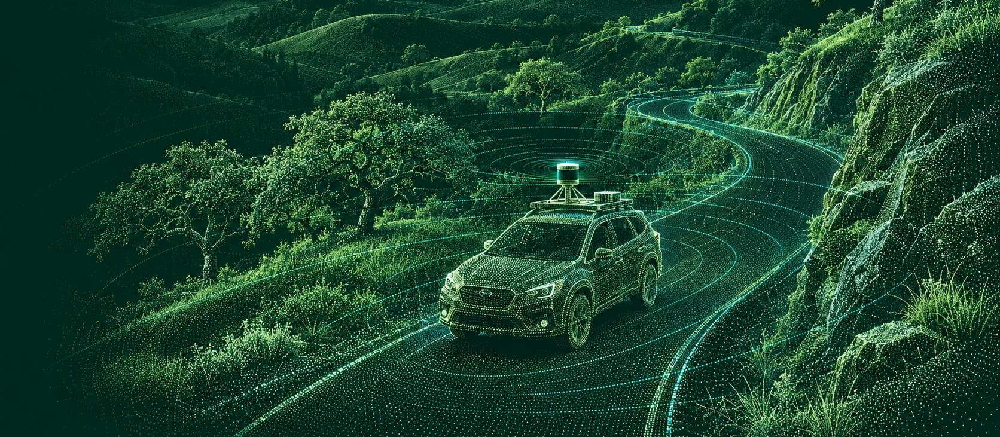

# D-CAPS 2027 Workshop Proposal

**International Workshop on Data, Computing, and Communication Infrastructure for Autonomous Physical Systems**

April 4, 2027 · Cal Poly Pomona, Pomona, California, USA\
Proposed full-day workshop at the Fifth IEEE International Conference on Mobility: Operations, Services, and Technologies (IEEE MOST 2027)

## Motivation and fit with IEEE MOST

Autonomous physical systems have the potential to transform transportation, manufacturing, and critical infrastructure by enabling machines to make and execute decisions under changing physical conditions. Advances in sensing, embedded computing, and control are extending the range of tasks these systems can undertake, from operations in structured environments to those that require continuous adaptation to uncertainty. Realizing these capabilities depends on the data, computing, and communication infrastructure that determines which physical states a system can observe, which decisions it can compute, and how reliably it can translate those decisions into action.

*Figure 1. An autonomous vehicle sensing its surroundings on a mountain road. Data, computing, and communication infrastructure determine what such a system can observe, decide, and do.*

The dynamics of a physical task impose coupled requirements on data fidelity and freshness, computational throughput, and communication latency, all of which must be sustained within the platform’s energy and resource budgets. These dependencies motivate a common research agenda across data systems, computer architecture, and networking to establish how design decisions at each layer affect the performance, dependability, and operating limits of the complete physical system.

D-CAPS brings together researchers and practitioners to advance the design, integration, and evaluation of infrastructure within individual platforms and across multiple systems, including general-purpose architectures and services with potential applications to autonomous physical systems. Co-location with IEEE MOST provides a forum for examining these infrastructure questions across land, air, and maritime mobility, where differences in physical dynamics, resource availability, and operating conditions can reveal which design principles generalize and where platform-specific solutions are necessary.

## Scope and topics of interest

The workshop welcomes foundational research, early results, prototype systems, measurement studies, and lessons from deployment across the following areas.

- **Data infrastructure** — Systems for acquiring, storing, managing, and processing data.
- **Computing infrastructure** — Hardware and software architectures for onboard, edge, and cloud computing.
- **Communication infrastructure** — Architectures and protocols for exchanging information within and across systems.
- **Sensing and actuation infrastructure** — Hardware and software that enable autonomous physical systems to observe and act on their environment.
- **AI and machine learning infrastructure** — Systems for training, deploying, and serving models.
- **Systems architecture and integration** — Design and integration of sensing, computing, communication, and control.
- **Infrastructure management and orchestration** — Methods for provisioning, configuring, and managing data, computing, and communication resources for autonomous physical systems.
- **Interoperability and standards** — Interfaces and standards that allow components from different vendors or platforms to work together.
- **Dependability, security, and privacy** — Methods for maintaining reliable operation and protecting systems and data.
- **Testbeds, measurement, and deployment** — Experimental platforms, evaluation methods, and lessons from real-world deployments.

## Proposed workshop program

The morning and afternoon sessions each feature five papers, with time for questions.

| Time (Pacific)   | Session                                    |
| ---------------- | ------------------------------------------ |
| 9:00–10:00 a.m.  | Keynote and audience Q&A                   |
| 10:00–10:20 a.m. | Coffee break                               |
| 10:20 a.m.–noon  | Paper presentations                        |
| Noon–1:30 p.m.   | Lunch                                      |
| 1:30–2:00 p.m.   | Industry panel and audience Q&A            |
| 2:00–3:20 p.m.   | Paper presentations                        |
| 3:30–3:35 p.m.   | Closing remarks                            |

Industry panelists will discuss which infrastructure constraints shaped a deployment, how their teams measured the effects on the physical system, and which problems remain open. The co-chairs will select the keynote speaker and panelists after workshop acceptance.

## Paper submission and review

Authors will submit original papers of up to six pages in the double-column IEEE conference template. The limit includes references and all other content. D-CAPS will use single-blind review. Authors will identify themselves on the manuscript, and reviewer identities will remain confidential.

The chairs plan to manage submissions and reviews through the D-CAPS HotCRP site ([dcaps.hotcrp.com](https://dcaps.hotcrp.com/)) and assign at least three independent reviews to every paper. Reviewers will assess originality, technical soundness, relevance to autonomous physical systems, and the evidence supporting the claims. Early-stage work may establish feasibility through analysis, simulation, or a preliminary experiment.

Authors, reviewers, and chairs will declare conflicts, including institutional affiliations, recent collaborations, and advising relationships. An unconflicted chair will oversee assignments, discussion, and decisions for each paper. If all chairs are conflicted, the IEEE MOST workshop chairs will be asked to designate an independent decision maker.

## Timeline and publicity

Upon acceptance, the organizers will issue the CFP by December 10, 2026, and circulate it through mobility, robotics, systems, and networking research communities and industry contacts. They will coordinate final manuscripts with the MOST publication team and chair the sessions on site.

We request a February 12, 2027 paper submission deadline. Author notification is scheduled for February 28, 2027. The co-chairs will confirm the camera-ready deadline with the IEEE MOST publication team.

The workshop website at [int-lab.github.io/dcaps2027](https://int-lab.github.io/dcaps2027/) hosts the call for papers, the proposed program, and downloadable materials.

## Workshop co-chairs

**Qiang Liu**, University of Nebraska–Lincoln · [qiang.liu@unl.edu](mailto\:qiang.liu@unl.edu)

**Nakjung Choi**, Nokia Bell Labs · [nakjung.choi@nokia-bell-labs.com](mailto\:nakjung.choi@nokia-bell-labs.com)

## Steering committee

- **Weisong Shi**, University of Delaware
- **TBD**, second member

## TPC members

- **Zheng Dong**, Wayne State University
- **Qi Chen**, Toyota Motor North America
- **Ahan Kak**, Nokia Bell Labs
- **Haoxin Wang**, Georgia State University

[IEEE MOST 2027 workshop information](https://www.ieeemobility.org/workshop.html)
